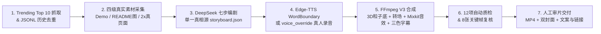

# GitHub Daily Radar (V3) — AI 开源热榜短视频全自动成片引擎 & Agent Skill

> **GitHub Trending Top 10 → 9:16 竖屏爆款科技短视频** · 真实开源数据 × 真实项目画面 × WordBoundary 字级同步字幕 × 3D 银白粒子极光动态底图 × 12 项自动质检 × 人工审片门禁。

[](./LICENSE)
[](#快速开始)
[](#v3-视觉与音画特性)

本仓库既是一个**可直接运行的 Python 自动化短视频生成项目**，也是一个开箱即用的 **AI Agent Skill（适配 Antigravity / Agent Skills 规范）**——将它接入你的 AI 编码助手后，只需一句话“帮我做一期今天的 GitHub 每日热门开源视频”，即可自动完成抓榜、拍素材、写稿、配音、剪辑渲染、12 项质检与文案输出。

---

## 核心能力与 V3 视觉特性

- **真实数据全链路可追溯**：直连 GitHub Trending 日/周榜 Top 10，结合 `gh` CLI 或 GitHub REST API 校验总 Star、周期增量、开源协议（杜绝 `NOASSERTION` 泄露），并用 JSONL 快照实现 `--dedupe-days` 多日去重。
- **四级真实项目素材自动采集**：官方 README 演示视频（`.mp4` / `.gif`） → README 架构/实图 → 项目 Avatar + 原生 CLI 命令 → Playwright 2x 高清官网/GitHub 仓库真页面长图滚动录屏，**绝不造假界面**。
- **头部科技博主口吻七步编剧**：`deepseek-chat` 严格按 `项目名 → Star 增长 → 一句话定位 → 核心功能 → 差异亮点 → 落地场景 → 推荐理由` 输出口播稿与配套视觉卡，带自动超长收紧保护。
- **零漂移 WordBoundary 字幕引擎**：`Edge-TTS`（`zh-CN-YunxiNeural` +15%）真实词级时间戳对齐；原子技术词合并（`Claude Code`, `Apache 2.0`, `.NET`）+ 语义平衡断句算法（绝不拆碎中文词）；同时支持 `voice_override/` 真人录音秒级重渲。
- **V3 动态视听合成**：
  - **6s 无缝 30fps 3D 银白粒子波纹 + 幽微祖母绿极光黑底**（全片按时间连续切片不跳帧）
  - **极简白底 Neo-Brutalist macOS 浏览器视窗卡** + `0.24s` 缓出进场 + `1.00→1.024` Ken Burns 微推 + 方向性转场
  - **Mixkit 免署名可商用 BGM（`tonight-hiphop.mp3`）+ 4 类分层转场音效** + `amix normalize=0` 饱满人声混音
  - **薄荷绿圆角底盒 ASS 三色高亮大字幕**（深墨底色 / 祖母绿英文技术词 / 橙红增长数字）
- **12 项自动质检 + 人工门禁**：自动验证音画差（`< 0.35s`）、黑屏 `0`、长静音 `0`、字幕无重叠与文稿 100% 匹配，并截出 8 张关键帧供复核。严格遵循 `PENDING_HUMAN_REVIEW`（绝不自动发布）。

---

## 全流程架构



详细原理、参数、实测数据与工程避坑指南请阅读完整流程手册：[**WORKFLOW_SUMMARY.md**](./WORKFLOW_SUMMARY.md)

---

## 作为 AI Agent Skill 安装使用

### Antigravity 全局安装（推荐）

```bash
git clone https://github.com/L22000011/github-daily-radar-skill.git ~/.gemini/config/skills/github-daily-radar
cd ~/.gemini/config/skills/github-daily-radar
pip install -r requirements.txt
```

> Windows PowerShell 对应全局目录为：`$HOME\.gemini\config\skills\github-daily-radar`。也可克隆到任意项目工作区的 `.agents/skills/github-daily-radar/` 目录中作为项目级 Skill 使用。

安装后配置环境变量 `DEEPSEEK_API_KEY` 并确保 `ffmpeg`/`ffprobe` 可用，直接对 Agent 说：
- “用 `github-daily-radar` 帮我做一期今天的 GitHub 每日热门开源视频”
- “做一期本周 GitHub Top 5 精选长版视频，顺便把发布文案和评论区链接一起给我”

---

## 快速开始（独立 CLI 运行）

### 1. 环境准备

- **Python**: `3.10+`
- **FFmpeg & FFprobe**: 确保已加入系统 `PATH`，或在 `.env` 中通过 `FFMPEG_EXE` / `FFPROBE_EXE` 指定路径
- **浏览器环境**: 已安装 Chrome 浏览器，或运行 `playwright install chromium`
- **GitHub 数据源**: 推荐登录 GitHub CLI (`gh auth login`)，也可配置环境变量 `GITHUB_TOKEN`（或使用匿名公开 API）

```bash
git clone https://github.com/L22000011/github-daily-radar-skill.git
cd github-daily-radar-skill
pip install -r requirements.txt
cp .env.example .env
# 编辑 .env 填入你的 DEEPSEEK_API_KEY
```

### 2. 一键生成每日 / 每周视频

```bash
# 每日热榜 Top 5（过滤 7 天内已推荐项目，默认语速 +15%）
python -u scripts/run_github_radar.py --period daily --top-n 5 --focus ai-dev --dedupe-days 7

# 每日快讯 Top 3（45-75 秒紧凑版）
python -u scripts/run_github_radar.py --period daily --top-n 3 --focus ai-dev

# 每周精选 Top 5（90-150 秒深度盘点）
python -u scripts/run_github_radar.py --period weekly --top-n 5 --focus ai-dev

# 替换为真人配音后秒级重渲（将 seg_XX.wav 放入 <out_dir>/voice_override/）
python -u scripts/run_github_radar.py --stage render --out-dir "./output/<run_dir>" --voice-dir "./output/<run_dir>/voice_override"
```

### 3. 本地 API 服务 + n8n 定时工作流

```bash
python -u scripts/server.py
```

启动后服务默认监听 `http://0.0.0.0:8010`（可通过 `GITHUB_RADAR_PORT` 修改），将 [`references/n8n-github-trending-pipeline.json`](./references/n8n-github-trending-pipeline.json) 导入 n8n 即可实现每周定时出片 + 人工审核门禁。

---

## 输出目录结构

每次运行会在 `./output/github_radar_<period>_<timestamp>/` 生成完整可追溯交付包：

- `final_9x16_clean.mp4` / `final_9x16_captioned.mp4` —— 交付主成片（带烧录三色高亮字幕，1080×1920 30fps）
- `final_9x16_no_subtitles.mp4` —— 无字幕纯净母版（适合剪映二次创作）
- `final_subtitles.srt` / `final_subtitles.ass` —— 字级同步外挂字幕
- `cover_9x16.png` / `cover_3x4.png` —— 竖屏与小红书图文双版封面
- `qa_report.json` / `QA_REPORT.md` + `qa_frames/` —— 12 项自动质检报告与 8 张关键帧截图
- `facts.md` / `sources.md` / `trending_report.json` / `storyboard.json` —— 完整数据与出处台账
- `voice_recording_sheet.md` / `voice_override/` —— 真人配音替换对照表
- `REVIEW_CHECKLIST.md` —— 人工审片核查清单

---

## 目录结构

```text
├── SKILL.md                             # AI Agent Skill 入口定义与执行规范
├── WORKFLOW_SUMMARY.md                  # 完整中文全流程深度指南（架构/算法/实测/避坑）
├── README.md                            # 项目主页说明
├── requirements.txt                     # Python 依赖清单
├── .env.example                         # 环境变量模板
├── scripts/
│   ├── config.py                        # 跨平台配置解析（.env / FFmpeg / Playwright / 字体）
│   ├── run_github_radar.py              # CLI 主调度入口
│   ├── fetcher.py                       # GitHub Trending 抓榜 + 4 级真实素材采集
│   ├── history.py                       # 历史快照持久化与多日去重
│   ├── scriptwriter.py                  # DeepSeek 七步流畅编剧 + 字数保护
│   ├── tts_engine.py                    # Edge-TTS WordBoundary + 中文平衡断句 + 真人覆盖
│   ├── renderer.py                      # V3 3D 粒子动态底 + 浏览器卡片 + Mixkit 音效 + 字幕合成
│   ├── qa_audit.py                      # 12 项自动质检与 QA 帧提取
│   └── server.py                        # FastAPI :8010 服务（对接 n8n）
├── assets/audio/                        # 内置 Mixkit 免署名可商用 BGM 与 4 类转场 SFX
└── references/
    ├── n8n-github-trending-pipeline.json
    ├── publish-templates.md             # 短视频文案 + 评论区置顶链接 + 主页简介模板
    └── qa-and-troubleshooting.md        # 12 项质检说明与常见问题排查
```

---

## 音频素材与开源许可

- 代码基于 **MIT License** 开源（见 [LICENSE](./LICENSE)）。
- 内置背景音乐与 4 个转场音效来自 **Mixkit Free License**（免署名可商用），详细清单见 [`assets/audio/ATTRIBUTION.md`](./assets/audio/ATTRIBUTION.md)。
