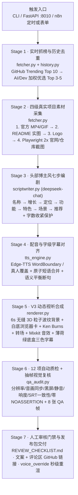

# GitHub 每日一集短视频全流程指南（GitHub Radar V3）

> **核心定位**：一套面向科技视频博主的 **9:16 竖屏（1080×1920 · 30FPS）GitHub 开源趋势盘点自动化成片流水线**。严格坚持 **真实数据源 + 真实项目画面 + 零漂移字级字幕 + 头部博主节奏化视听 + 12 项自动质检 + 人工审核门禁（`PENDING_HUMAN_REVIEW` / `MANUAL_ONLY_NO_AUTO_PUBLISH`）**，支持日常每日快讯（45–145s）与每周精选（90–150s），适配抖音、B站、小红书、微信视频号。

---

## 一、端到端全流程架构图



---

## 二、成品硬标准与视觉规范

| 维度 | 规范参数 | 说明 |
|---|---|---|
| **分辨率与帧率** | `1080×1920` (9:16 竖屏) · `30 FPS` · H.264 + AAC | 手机端全屏满视野，封面额外输出 `3:4` (`1080×1440`) 适配小红书/图文 |
| **时长节奏** | `daily` Top 3: `45–75s`；Top 5: `90–145s`；`weekly` Top 5: `90–150s` | 语速默认 `+15%`，单项目控制在 `15–25s` 紧凑推进 |
| **视觉版式（V3）** | 深邃黑底 + **6s 无缝 3D 银白粒子波纹与祖母绿极光动态背景** + 极简白底 Neo-Brutalist macOS 浏览器卡片（`GitHub风向标`） | 告别静态纯色/天蓝背景；上下粒子场按时间戳连续相位切片，跨 7 段无缝流动不跳帧 |
| **字幕设计（V3）** | ASS `BorderStyle=3` 圆角薄荷绿底盒（`&H00E4FCEB`）· `Fontsize=52` · `Outline=13` · `80ms` 微弹入 | **三色高亮**：深墨正文 `#141416` · 祖母绿技术词 `#047857` · 橙红数据与排名 `#C2410C` |
| **音频响度** | 语音 `loudnorm=-16 LUFS` + Mixkit BGM（3400Hz 低通，`0.095`）+ 4 类分层 SFX，`amix normalize=0 + alimiter=0.95` | 实测全片平均响度约 `-16.6 dB`，人声清亮不闷 |
| **合规红线** | 所有数据/功能/截图可追溯至 `facts.md` 与 `sources.md`；**禁止自动发布** | 输出状态锁定 `PENDING_HUMAN_REVIEW` / `MANUAL_ONLY_NO_AUTO_PUBLISH` |

---

## 三、七大核心阶段详拆

### Stage 1：实时抓榜、历史快照与赛道筛选（`scripts/fetcher.py` + `scripts/history.py`）

1. **真实榜源抓取**：
   - `scrape_trending(period, limit=10)` 直接抓取 `https://github.com/trending?since={daily|weekly}` 的实时 Top 10 仓库、描述、编程语言与周期新增 Star。
   - `_gh_api_json` 优先调用本机已登录的 `gh api repos/{full_name}`，若无 `gh` CLI 则自动降级到 GitHub REST API（支持环境变量 `GITHUB_TOKEN` / `GH_TOKEN`）补全真实总 Star 数（`stargazers_count`）、Fork、Topics、Homepage、默认分支与开源协议，并彻底清洗 GitHub 的 `NOASSERTION` 为可读说明（零泄露）。
2. **智能筛选与多日去重**：
   - 结合 `AI_DEV_KEYWORDS`（`agent`, `mcp`, `claude`, `codex`, `llm`, `rag`, `cli`, `devtools`, `workflow`, `skill` 等）计算 `selection_score`，优先精选高技术价值的 AI / Agent / 开发者提效工具。
   - 每次运行向 `output/history/trending_snapshots.jsonl` 追加一次历史快照（`append_snapshot`）。当传入 `--dedupe-days N` 时，`load_recent_selected(days=N)` 会自动对近期已讲过的仓库软降权，避免连续几天撞车；若存在 6 小时以上的历史快照，还能计算真实增量（`compute_historical_delta`）。
3. **本阶段产物**：
   - `trending_report.json`（完整 Top 10 原始数据 + 精选 Top N 事实台账）
   - `facts.md` / `sources.md`（每个项目的 GitHub 地址、总 Star、增量 Star、协议与真实素材出处）

---

### Stage 2：四级真实项目素材采集（`scripts/fetcher.py`）

严格遵循**“真页面、真演示、不造假 UI”**原则，按优先级采集每个精选项目的视听卡片素材：

| 优先级 | 采集方式 | 质量校验规则 |
|---|---|---|
| **Tier 1** | 官方 README 中的真实演示视频 / GIF（`.mp4` / `.webm` / `.mov` / `.gif` / `user-attachments/assets`） | 下载上限 35MB，经 `ffprobe` 校验分辨率 `>= 320×180`、视频时长 `>= 1.2s`（GIF `>= 1.0s` 或 `>= 4` 帧） |
| **Tier 2** | README 真实项目截图、架构图或效果对比图 | 过滤 `shields.io` / `badge` / `codecov` / `star-history` / `sponsors` 等徽章与挂件，保留尺寸 `>= 480×240` 的高价值实图 |
| **Tier 3** | 组织头像 / 项目 Logo + 原生 CLI 安装命令 | 拉取 `avatar.png`（`>= 64×64`），`_extract_cli_snippet` 从 README 代码块原样提取首条真实安装命令 |
| **Tier 4** | Playwright Headless 2x 高清真页面抓拍 | `launch_chromium` 打开官网首页（`home.png`，跳过社交媒体域名）与 GitHub 仓库主页（`github.png`），截取最高 1280px 纵向长图，供 Beat 2 / Beat 3 进行浏览器窗口平滑滚动演示 |

---

### Stage 3：头部科技博主风格七步编剧（`scripts/scriptwriter.py`）

1. **统一结构与口播红线**：
   - 调用 `deepseek-chat`（JSON Mode，`temperature=0.35`）严格基于 `repo_facts` 编写：
     - **开头 Hook（3–5 秒）**：抛出今日/本周核心看点与总榜亮点。
     - **主体 7 要素（每项目 15–25 秒）**：**项目名称 → Star 增长 → 一句话定位 → 核心功能 → 差异化亮点 → 典型落地场景 → 适合人群与推荐结论**。
     - **结尾 Outro（4–6 秒）**：干脆收束并抛出互动问题，不搞冗长三连套话。
2. **自然语言表达规范**：
   - 口播数字转为自然中文读法（如「两千多星」「六万多星」），禁用英文逗号分隔数字（防止 TTS 顿挫错读）。
   - 保留规范英文专业术语拼写（`GitHub`, `Python`, `Claude Code`, `MCP`, `LLM`, `SKILL.md`, `Apache 2.0`, `TypeScript`, `.NET` 等）。
   - 严禁把 `owner/repo` 读成“斜杠”，自动改写为自然的项目/团队简称。
   - **项目间自然承接变化**：引入多样化衔接语（「第二个来看…」「紧接着第三名…」「再看排第四的…」「最后压轴的是…」），避免机械“第 X 个项目是”模板感。
3. **自动字数收紧保护**：
   - 若生成稿件超出目标字数上限（如 Top 5 单项目超时风险），自动触发一轮 `tighten_prompt` 压缩改写并保留全部 7 要素与真实数字。
4. **“文案先定、双轨同源”输出**：
   - 唯一真相源：`storyboard.json` + `voice_recording_sheet.md`（配音与字幕 **100% 源自同一段 `spoken_text`**）。

---

### Stage 4：语音合成与零漂移字级字幕对齐（`scripts/tts_engine.py`）

1. **三引擎分级支持（优先真人与高自然度音色）**：
   - **Human Override（最高优先）**：若在 `voice_override/` 放入 `seg_00_hook.wav` 等真人录音，对应分段无缝切换为真人配音（支持只替换部分分段），并经 FFmpeg `loudnorm=I=-16:TP=-1.5:LRA=11` 标准化至 44.1kHz PCM WAV。
   - **Edge-TTS（默认主力）**：使用 `zh-CN-YunxiNeural`（默认语速 `+15%`），开启 `boundary="WordBoundary"` 捕获微软原生逐词毫秒级时间戳。
   - **DashScope CosyVoice（可选商业兜底）**：配置 `DASHSCOPE_API_KEY` 后可选 `--tts dashscope`。
2. **字幕零错位、零拆词三大核心算法**：
   - **原子短语合并（`_merge_atomic_phrases`）**：把 `Claude Code`、`Apache 2.0`、`SKILL.md`、`.NET`、`GPT-4o` 等多词/带点术语锁为不可拆分整体。
   - **语义平衡切分（`_find_natural_split_idx`）**：当长句超过 `16.0` 显示宽度单位时，结合标点停顿、左右平衡度、语法边界词（`的/了/把/在/让/能/可以/如果/而且…`）与不可拆常用词表 `_AVOID_SPLIT_WORDS`（例如绝不把「爆火」拆成「爆 / 火」），智能寻找最佳断点。
   - **孤儿短语吸收（`_merge_short_orphan_cues`）**：杜绝单个 `Agent`、`CLI` 闪现一帧，自动合并至相邻分句，并严格强制单调不重叠时间轴。

---

### Stage 5：V3 动态视听合成引擎（`scripts/renderer.py`）

V3 引擎彻底升级了视觉质感与动效节奏：

1. **无缝 3D 银白粒子波纹 + 幽微极光动态背景（`generate_animated_dot_wave_bg`）**：
   - 使用 NumPy 向量化计算上下两片透视 3D 正弦双波叠加网格粒子场与极光光晕，生成 `6.0s`（180 帧 `2*pi` 严格周期闭合）的 30fps `1080×1920` 循环底片。
   - 在 FFmpeg 阶段通过 `-stream_loop -1 -ss {cur_t:.3f}` 按全片绝对时间戳**连续相位切片**喂给所有 7 个分段，确保全片背景粒子从头到尾丝滑起伏不跳跃。
   - *关键工程设计*：向 FFmpeg `stdin` 写入 rawvideo 时强制设置 `stderr=subprocess.DEVNULL`，彻底杜绝 Windows 管道缓冲区 4KB 写满导致的进程死锁。
2. **极简白底 Neo-Brutalist macOS 浏览器卡片**：
   - Playwright 渲染透明 PNG 图层与 SVG 圆角描边双色大标题（`_stroked_svg_title`）：白字主标 + 薄荷绿高亮关键字（`#4ADE80`），适配深黑粒子顶区与底区留白。
   - 中央统一白色硬朗阴影视窗卡片：macOS 三色圆点 + `GitHub风向标` 徽标 + 开源协议 Tag。
   - **每项目 4 拍视觉随语音切换（`_beat_timing` + `_pick_beat2_and_beat3`）**：
     - **Beat 1（0%–30%）**：大字号数据与 Star 增长面板（`+X,XXX` 增量 + 总 Star + 语言 + VERDICT 推荐标签），伴随 `1.00→1.024` Ken Burns 微推。
     - **Beat 2（30%–62%）**：优先真实 `.mp4` / `.gif` Demo（适配 `978×744` 横屏舞台 + 底部 `194px` 杂志图注条展示关键差异与 CLI 命令），或首页平滑滚动截屏。
     - **Beat 3（62%–82%）**：优先展示 README 第二张实图，或 GitHub 仓库页真实长图滚动扫描。
     - **Beat 4（82%–100%）**：结构化价值卡（一句话定位 + 核心功能 + 典型使用场景 + 适用人群），同样伴随 Ken Burns 微推。
   - **进场与转场动效**：卡片首帧带 `0.24s` 二次缓出从底部浮入动画；拍与拍之间采用方向性 `smoothleft` / `slideleft` / `smoothup`（`0.30s`），紧凑利落、拒绝无意义花哨特效。
3. **专业 Mixkit BGM + 分层转场音效混音**：
   - 内置免署名可商用 Mixkit Hip-Hop BGM（`tonight-hiphop.mp3`，经 `3400Hz` 低通滤波避免抢人声频段，`volume=0.095`）+ 4 类采样音效精准踩点：
     - `pk-impact-hit-fast-exciting.mp3`：Hook 0.04s 震撼开场
     - `pk-transition-wind-swoosh-short.mp3`：每个新项目 / Outro 切换风声
     - `pk-ui-pop.mp3`：Beat 2 真实演示切换 UI 弹出音
     - `pk-paper-paper-slide.mp3`：Beat 4 总结价值卡纸张滑入音
   - 通过 FFmpeg `[a_voice][a_bgm][a_sfx]amix=inputs=3:duration=first:normalize=0,alimiter=limit=0.95` 混合，保留人声完整动态。
4. **集成白底薄荷绿底盒三色高亮动态字幕**：
   - 将 ASS 字幕精确定位到卡片底部集成纯白字幕槽区域，配 `80ms` 轻微弹性缩放弹出（`\fscx96\fscy96\t(0,80,\fscx100\fscy100)`）。
   - 单次合并正则 `_ASS_HL_RE` 同步高亮绿色技术名词与橙红色 Star/排名数字，防止转义标签被二次污染。
   - 渲染输出双版本母版：**`final_9x16_no_subtitles.mp4`**（无字幕纯净版，便于剪映精修）+ **`final_9x16_captioned.mp4`** & **`final_9x16_clean.mp4`**（烧录动态高亮字幕交付主文件）+ `cover_9x16.png` + `cover_3x4.png` + `talkcraft_handoff/`。

---

### Stage 6：12 项自动质检 + 人工抽帧复核（`scripts/qa_audit.py`）

渲染结束后自动执行 12 项硬门禁检查并生成 `qa_report.json` / `QA_REPORT.md`，同时截取 8 张核心关键帧（`qa_frames/`）供 AI / 人工视觉复核：

1. `resolution_1080x1920`：视频严格为 `1080×1920`
2. `codecs_h264_aac`：标准 `H.264 + AAC` 编码
3. `av_sync_under_0_35s`：音画时长差 `< 0.35s`
4. `no_black_frames`：`blackdetect` 黑屏事件 `= 0`
5. `no_long_silence`：`silencedetect (>1.5s)` 异常静音 `= 0`
6. `audible_mean_volume`：全片平均音量在 `-28.0 ~ -8.0 dB` 合理区间
7. `srt_zero_overlaps`：SRT 字幕时间轴 `0` 重叠
8. `srt_no_broken_tokens`：无句尾悬空小数点或截断英文 Token
9. `srt_exact_text_match`：字幕归一化文本与口播稿一致率 `>= 0.99`（理想 `1.0`）
10. `facts_consistent`：所有项目 Star 总数/增量与抓包原始数据完全一致
11. `no_noassertion_leak`：台账、字幕、画面绝无原始 `NOASSERTION` 泄露
12. `clean_mp4_matches_captioned`：主交付文件 `final_9x16_clean.mp4` 与 `final_9x16_captioned.mp4` 完全一致且有效

---

### Stage 7：人工审核门禁与发布交付（`REVIEW_CHECKLIST.md`）

1. 检查输出目录中的核心交付物：
   - 成片主文件：`final_9x16_clean.mp4`（同时保留无字幕母版 `final_9x16_no_subtitles.mp4` 与外挂 `final_subtitles.srt`）
   - 双平台封面：`cover_9x16.png`（抖音/视频号/B站）+ `cover_3x4.png`（小红书图文/笔记）
   - 核验台账：`facts.md` · `sources.md` · `REVIEW_CHECKLIST.md` · `QA_REPORT.md`
2. **如需真人配音替换**：按 `voice_recording_sheet.md` 将录音（如 `seg_01_superpowers.wav`）放入 `voice_override/`，加 `--stage render --voice-dir ...` 秒级重新合成。
3. **手动发布文案与置顶评论**：结合当日 `facts.md` 生成精炼短视频文案 + **单独分栏的评论区 5 个 GitHub 仓库直达链接**，人工确认后上传。

---

## 四、日常 CLI 命令与自动化调度

### 1. CLI 一键运行

```bash
# 安装依赖（首次）
pip install -r requirements.txt
playwright install chromium   # 若本机未安装 Chrome

# 配置环境变量（参考 .env.example）
# DEEPSEEK_API_KEY=your_deepseek_api_key_here

# 每日模式：抓取今日 Trending Top 10，精选 Top 5（过滤 7 天内已讲项目）
python -u scripts/run_github_radar.py --period daily --top-n 5 --focus ai-dev --dedupe-days 7

# 每周模式：周榜精选 Top 5（默认 90-150s）
python -u scripts/run_github_radar.py --period weekly --top-n 5 --focus ai-dev

# 快讯模式：每日 Top 3（45-75s）
python -u scripts/run_github_radar.py --period daily --top-n 3 --focus ai-dev

# 替换真人录音后跳过抓包与写稿，秒级重渲
python -u scripts/run_github_radar.py --stage render --out-dir "./output/<run_dir>" --voice-dir "./output/<run_dir>/voice_override"
```

### 2. FastAPI + n8n 定时工作流（`:8010`）

- 启动本地 API 服务：`python -u scripts/server.py`
  - `GET /health`
  - `POST /api/radar/run`（提交后台出片任务）
  - `GET /api/radar/status/{job_id}`（轮询状态与日志）
  - `POST /api/radar/rerender/{job_id}`（在 n8n 审核门禁中触发真人配音重渲）
- 在 n8n 导入 [`references/n8n-github-trending-pipeline.json`](./references/n8n-github-trending-pipeline.json)，支持 **Schedule Cron 定时跑** 与 **Form 表单手动跑**，并在 **Human Review Gate** 强制暂停等待人工把关。

---

## 五、V3 实测基准数据（2026.11.19 日榜实测留档）

- **运行参数**：`--period daily --top-n 5 --focus ai-dev --dedupe-days 7 --rate "+15%"`
- **入选 Top 5 开源项目**：
  1. `obra/superpowers`（`+2,028`, `322,332★`, `MIT`, Shell）
  2. `elementalsouls/Claude-BugHunter`（`+1,349`, `13,031★`, `MIT`, Python, 官网长图）
  3. `mvanhorn/last30days-skill`（`+954`, `71,027★`, `MIT`, Python, CLI）
  4. `HKUDS/CLI-Anything`（`+898`, `60,813★`, `Apache-2.0`, Python, 官网长图 + 2 张 README 实图 + CLI）
  5. `firecrawl/firecrawl`（`+825`, `204,571★`, `AGPL-3.0`, TypeScript, 官网长图 + 2 张 README 实图 + CLI）
- **成片与质检指标**（实测 `qa_report.json` 全量记录）：
  - 分辨率与帧率：`1080×1920`, `30/1 fps`, 时长 `140.267s`（音频 `140.347s`，音画差 **`0.081s`**）
  - 成片体积：`38,690,175 bytes`（~36.9 MiB / 38.69 MB），`12/12` 项质检全部 **`PASS`**
  - 音质与字幕：平均响度 **`-16.6 dB`**，黑屏 `0` 次，长静音 `0` 次；共 **`74` 条字幕**，`0` 重叠、`0` 错误断词、文本匹配率 **`100%`**（`1.0`）
  - 动态粒子校验：1.0s vs 2.5s 上下区域像素帧差 `top=10.676`、`bot=11.617`

---

## 六、关键工程避坑记录（已固化进源码）

1. **Windows FFmpeg `rawvideo` 管道死锁**：使用 `subprocess.Popen(stdin=PIPE, stderr=PIPE)` 向 FFmpeg 喂大尺寸 RGB 帧时，未读取的 `stderr` 超过 OS 4KB 缓冲区会双向阻塞卡死。**已修复**：`generate_animated_dot_wave_bg` 强制 `stderr=subprocess.DEVNULL`。
2. **Windows ASS 烧录路径盘符冒号转义坑**：FFmpeg `ass=` 滤镜会把 `C:\...` 中的冒号误解析为滤镜参数分隔符。**已修复**：渲染时切换 `cwd=out_dir` 并只传入相对文件名 `ass=final_subtitles.ass`。
3. **FFmpeg `amix` 默认人声减半坑**：默认 `normalize=1` 会将 3 轨输入平均除以 3（导致整体音量跌至 `-23.5 dB`）。**已修复**：显式指定 `amix=inputs=3:duration=first:normalize=0,alimiter=limit=0.95`。
4. **中文短语被拆词与英文术语撕裂**：短 `max_units` 曾导致「爆火」被切为两半、`Apache 2.0` 被点号拆断。**已修复**：`_merge_atomic_phrases` + `_AVOID_SPLIT_WORDS` + `_find_natural_split_idx` 语义平衡算法。
5. **ASS 高亮标签二次正则污染**：先后两次替换英文与数字会导致首次写入的 `{\c&H...&}` 里的十六进制数字再次被数字正则命中。**已修复**：合并为单次正则交替 `_ASS_HL_RE`（`(?P<term>...)|(?P<num>...)`）一次完成着染色。
